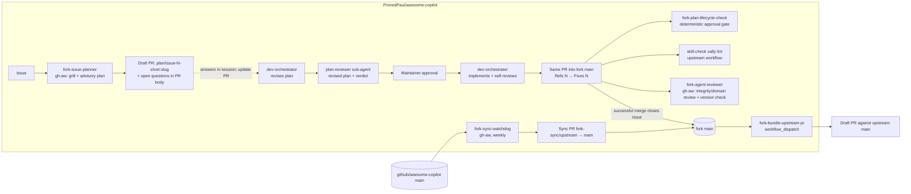

# Fork-Only Automation Tooling

Fork-specific workflows, agents, and documentation for developing the **Oracle-to-PostgreSQL Migration Expert** custom agent in `PrimedPaul/awesome-copilot` (a fork of `github/awesome-copilot`) and promoting it upstream.

> **Fork-only.** Nothing in `.github/fork-only/` or `.github/workflows/fork-*` is ever proposed upstream. Only the agent file, its plugin, and its skills are promoted.

## Status

**Authored, compiled, lint-checked, watchdog-exercised, and reviewer green- and negative-path verified in Actions.** The bundler is verified end-to-end; see [First-run checklist](#first-run-checklist).

## Architecture



### Workflows (`.github/workflows/fork-*`)

| File | Kind | Trigger | What it does |
| --- | --- | --- | --- |
| `fork-issue-planner.md` → `.lock.yml` | gh-aw | `issues: [opened]` by the repo owner (excluding `fork-automation`-labelled issues), plus `workflow_dispatch` with an `issue_number` input | Does the first round of grilling and planning without a human in the loop. Reads the issue and the files it plausibly touches, classifies scope (agent / fork tooling / out of scope), writes `.github/fork-only/plans/issue-<N>-<short-slug>.md` beginning with parseable YAML frontmatter delimited by `---` (always `status: draft`) and containing a grilling pass (ambiguities, IN/OUT scope, constraints, **assumptions made**), a concrete plan with the semver bump level, acceptance criteria, `Q<n>`-numbered open questions, and verification commands. Opens a **draft** PR on the matching `plan/issue-<N>-<short-slug>` branch with the open questions and answer template in its body. Reruns preserve the existing plan filename and branch. `allowed-files` restricts it to `.github/fork-only/plans/issue-*.md` — it can never touch the agent, the plugin, the skills, or any workflow. |
| `fork-sync-watchdog.md` → `.lock.yml` | gh-aw | Weekly Fri 10:00 UTC, manual | Deterministic `sync` job pushes `upstream/main` to branch `fork-sync/upstream` and opens/refreshes a PR into `main` (with the PAT so CI runs). AI agent comments on that PR with a summary, incoming commits, change footprint, anything touching this agent, and a **Keep / Disable / Integrate** verdict for every newly added upstream workflow file (with disable steps and, for Integrate, which fork file to change), plus a one-line impact note for each modified upstream workflow. If `CONTRIBUTING.md` or `AGENTS.md` changed, it also opens an issue with the full diff and what it means for this fork. |
| `fork-agent-reviewer.md` → `.lock.yml` | gh-aw | `pull_request` into `main`, path-scoped to the agent, plugin, and `skills/*oracle-to-postgres*` | `version_check` job fails if `plugin.json` version equals upstream. AI agent verifies integrity, Oracle→PostgreSQL domain correctness, safety boundaries, rule consistency, and promotion readiness, then submits one review (`COMMENT` or `REQUEST_CHANGES`; can never `APPROVE`). |
| `fork-plan-lifecycle-check.yml` | plain YAML | `pull_request` into `main`, path-scoped to lifecycle docs/tooling/plans and the agent, plugin, and `skills/*oracle-to-postgres*`; reruns on PR edits and label changes | Deterministic (`eng/validate-fork-plan-lifecycle.mjs`, no AI agent) check that a plan's `status: approved` claim is backed by machine-readable lifecycle evidence — requirements answered, review completed/waived, and an exact `Approve plan` comment from the repo owner on the planning PR, linked to the plan's current content hash — and that `Fixes #N` is only armed once that evidence checks out and GitHub's own `closingIssuesReferences` agrees. Tooling-only PRs require the `fork-lifecycle-maintenance` label and must stay within the explicit allowlist; every applicable PR runs focused regression tests. See `.github/fork-only/plans/README.md`. |
| `fork-bundle-upstream-pr.yml` | plain YAML | `workflow_dispatch` | Computes the single diff between `upstream/main` and fork `main` for the agent paths (agent file, plugin, every skill listed in `plugin.json`), applies it on a branch based on `upstream/main`, runs `npm run build` + `eng/fix-line-endings.sh`, commits, force-pushes the version-scoped promotion branch `upstream-promotion/oracle-to-postgres-migration-expert-v<plugin.json version>` to the fork, and opens a **draft** PR against upstream (or reports the existing one). Fails hard if there is no delta, the version was not bumped, the version is not a safe branch-name token, the diff does not apply, or any staged/committed path is outside the promotion allowlist. Supports `dry_run`. |

The gh-aw sources live in `.github/workflows/*.md` alongside their compiled `.lock.yml`, following upstream's convention for its own live agentic workflows (the top-level `workflows/` directory is the *contribution catalog*, not where this repo's automation runs). Recompile after editing a source: `gh aw compile --validate fork-sync-watchdog fork-agent-reviewer fork-issue-planner`.

### Agents (`.github/agents/`)

Custom agents for interactive Copilot CLI sessions; they are not run by Actions. They live under `.github/agents/` — not `.github/fork-only/agents/` — because Copilot CLI only discovers selectable custom agents in `.github/agents/` (repo-level) or `~/.copilot/agents/` (user-level); a `.github/fork-only/agents/` file is never scanned and cannot be selected with `/agent`. This is still fork-only tooling: neither `npm run build`/`skill-check` (which only walk the top-level `agents/**`) nor `fork-bundle-upstream-pr` (which derives its promotion allowlist from the migration-expert agent's own `plugin.json` — the agent file and plugin directory from its `agents[]` entries and manifest location, skills from its `skills[]` entries) ever look at `.github/agents/`, so nothing here can leak upstream.

- **dev-orchestrator.agent.md** — issue → interactive questions and answers → revised plan → Plan Reviewer verdict → explicit approval on the PR → implementation → pre-PR self-review → native issue closure. Resolves the unique `.github/fork-only/plans/issue-<N>[-<slug>].md` and planning PR, treating the seed as advisory. Records session answers in the plan's decision record and updates the PR. Only sets `status: approved` after review and an exact `Approve plan` comment from the repository owner on that PR. After implementation and validation, it changes or adds the PR's native issue reference and verifies GitHub's closing reference; no hidden marker or copied hash is required. Ends with the promotion checklist (version bump, `npm run build`, line endings, validators). Selectable via `/agent` (`mode: primary`, `hidden: false`, `user-invocable: true`).
- **plan-reviewer.agent.md** — independent, read-only rubber-duck review of the revised plan's substance (feasibility, testable acceptance criteria, Oracle-to-PostgreSQL correctness, scope, omissions, and whether recorded decisions are supported by the cited source). It reasons through the plan and challenges assumptions where warranted without manufacturing objections. The orchestrator dispatches this hidden sub-agent (`mode: subagent`, `hidden: true`, `user-invocable: false`) and requires a verdict of `no material concerns` (with a `Checked:` line) or `material concerns` with evidenced findings. It does not audit approval gates; the orchestrator and `fork-plan-lifecycle-check.yml` own those. It verifies cited PR comments itself; decisions supplied directly by the maintainer in the orchestrator session must be identified as session answers, not presented as comments. A failed dispatch or invalid result is not a completed review; the maintainer decides whether to retry or explicitly proceed without one.

### No state files

Earlier drafts tracked "last seen" SHAs in JSON. That was a second source of truth that could drift. Everything is now computed against `upstream/main`: unmerged upstream commits are simply `origin/main..upstream/main`, and the unpromoted agent delta is simply `git diff upstream/main origin/main -- <agent paths>`.

Plan files under `.github/fork-only/plans/` were originally **advisory artefacts, not state**: nothing read them automatically and nothing branched on their contents, so a stale plan was a stale note. That changed for the `approved` claim specifically: `fork-plan-lifecycle-check.yml` now reads a plan's `lifecycle` frontmatter and fails the PR if `status: approved` isn't backed by evidence (requirements answered, review completed/waived, an exact owner-authored `Approve plan` comment on the PR, and a content hash that still matches). The plan's *prose* — the grilling, the plan itself, the acceptance criteria — remains advisory; only the approval claim is now enforced. For changes to this gate itself, a maintainer applies the narrow `fork-lifecycle-maintenance` label after confirming the allowlisted tooling-only diff; mixed or implementation changes cannot use this route. See `.github/fork-only/plans/README.md` for the full contract.

## Repository settings this design depends on

Verified via the REST API on 2026-09-17. Re-check if behaviour looks wrong.

| Setting | Value | Why |
| --- | --- | --- |
| Actions → General → Actions permissions | *Allow PrimedPaul, and select non-PrimedPaul actions* with **Allow actions created by GitHub** ticked | The allow-list governs `uses:` steps, not which workflow files run. Without GitHub-owned actions every workflow fails at checkout. |
| Actions → General → **Require actions to be pinned to a full-length commit SHA** | **On** | Enforces SHA pinning at the runner. Any unpinned `uses:` is rejected. |
| Actions → General → Workflow permissions | Read-only; cannot approve PRs | Least privilege. Each workflow declares the `permissions:` it needs. |
| Ruleset "Branch Protection for 'main'" | deletion, non-fast-forward, `pull_request` (0 approvals), Copilot code review | Nothing pushes to `main` directly — the watchdog and bundler open PRs. Linear history is **off** so sync PRs can use *Create a merge commit*. |
| Ruleset → `pull_request` → *Require approval of the most recent reviewable push* / *extra approval for unattributed changes* | Recommended **off** | Automation commits are authored by `github-actions[bot]`; with 0 required approvals these are harmless but noisy. |

### Which upstream workflows to leave enabled

Upstream ships ~40 workflows that will all run in the fork. Disable the ones that assume upstream secrets or org context via the Actions tab (**⋯ → Disable workflow**; this is repository state, not a file, so it survives syncs). Keep enabled:

- `skill-check.yml` + `skill-check-comment.yml` — free vally lint on agent/skill changes
- `validate-plugins.yml`, `validate-readme.yml`, `validate-agentic-workflows-pr.yml` — the checks an upstream PR will face
- `fork-*` — ours

The watchdog applies this policy to every **newly added** upstream workflow file in its sync-PR comment: a per-file **Keep / Disable / Integrate** recommendation with reasoning, the exact disable steps, and — for *Integrate* — what to change in the fork's own tooling. It also notes whether **modified** upstream workflows change anything for a fork that keeps them enabled. The verdicts are suggestions; you decide after merging. If you change this list, the agent's policy lives in the *About this fork* section of `fork-sync-watchdog.md` — keep the two in step.

## Secret: `FORK_AUTOMATION_PAT`

One **classic** PAT with the **`public_repo`** and **`workflow`** scopes. Fine-grained PATs cannot be granted on `github/awesome-copilot` (you do not own it), and `public_repo` is the minimum classic scope that can open a PR against a public repo you do not own. `workflow` is required because the watchdog pushes `upstream/main` — which routinely contains changes under `.github/workflows/` — and GitHub refuses any push that touches workflow files from a token without that scope (`GITHUB_TOKEN` cannot do it either).

Used for exactly two things, both in deterministic (non-agent) jobs:

1. **Watchdog `sync` job** — checkout token, pushing `fork-sync/upstream`, and `gh pr create` on the fork. A PR created with `GITHUB_TOKEN` would not trigger `pull_request` workflows; a PAT-created one does.
2. **Bundler** — `gh pr create --repo github/awesome-copilot`. The promotion branch itself is pushed to the fork with `GITHUB_TOKEN`.

The PAT is **never** available to a gh-aw agent job. gh-aw's compiler reports it as a "new restricted secret" on first compile of the watchdog; that is expected and has been reviewed.

`fork-issue-planner` does **not** use the PAT. Its draft PR is opened with `GITHUB_TOKEN`, which means the plan PR does not trigger `pull_request` workflows — harmless, because a plan-only PR has nothing for CI to check. CI starts once you push implementation commits to that branch yourself.

Set an expiry (90 days) and note the renewal date in your calendar. To rotate: **Settings → Secrets and variables → Actions → `FORK_AUTOMATION_PAT`**.

### Copilot for gh-aw

The gh-aw workflows use the Copilot engine and request `copilot-requests: write`. Your account's Copilot subscription is what runs them. If the agent job fails at engine start-up, check the gh-aw [engines reference](https://github.github.com/gh-aw/reference/engines/) for the current credential requirement.

## Using the system

### Development flow

**Where each part of the work lives.** Keep the request, interactive discussion, and durable PR record connected:

| Surface | What belongs there |
| --- | --- |
| The **issue** | The original request and its context. |
| The **planning PR** (`plan/issue-<N>-<short-slug>`) | The evolving plan, open questions, decision record, review evidence, approval comment, and implementation diff. It becomes the implementation PR. |
| The **Development Orchestrator** session | Reads the issue and PR, asks unresolved questions interactively, records your answers on the PR, obtains an independent plan review, and waits for your explicit PR approval before implementing. |

Answering questions is not approval, and a clean Plan Reviewer verdict is not approval. The plan stays `status: draft` until all three gates pass — questions answered, review completed or explicitly waived, and your approval given.

1. Open an issue in the fork describing the change.
2. **Fork Issue Planner** fires automatically (owner-opened issues only, `fork-automation`-labelled ones excluded). Within a few minutes you get a draft PR `[plan] plan: issue #N — …` on branch `plan/issue-<N>-<short-slug>` containing `.github/fork-only/plans/issue-<N>-<short-slug>.md` with `---`-delimited YAML frontmatter (always `status: draft`), plus the plan's open questions and an answer template in the PR body.
3. In Copilot CLI, check out the planner PR's branch, select **Development Orchestrator** (`/agent` → `.github/agents/dev-orchestrator.agent.md`), and give it the issue number. It reads the issue, PR, and plan; asks you unresolved questions in the session; then records your answers in the plan's `## Decision record` and publishes the revised plan on the PR.
4. The orchestrator dispatches **Plan Reviewer** for an independent rubber-duck review and incorporates valid findings. It presents the reviewed plan on the PR and asks you to leave the exact comment `Approve plan` on that PR. The comment is the durable, attributable approval; the orchestrator records the hash and lifecycle metadata for you. If review dispatch or its verdict fails, it tells you the plan was not reviewed and asks whether to retry or proceed without review. A clean reviewer verdict or session-only approval is not approval.
5. After approval, the orchestrator implements, bumps `plugin.json` version, runs `npm run build`, and self-reviews.
6. Once implementation and validation pass, the orchestrator changes the PR's standalone `Refs #N` line to `Fixes #N` (or adds the native reference if missing), then verifies GitHub lists issue #N in `closingIssuesReferences`. It refuses to arm a plan-only PR or a second PR for the same issue. No hidden marker is required.
7. Mark the implementation PR *Ready for review*. `skill-check` (vally) and `fork-agent-reviewer` run. The reviewer's `version_check` job fails if the version was not bumped.
8. Merge when satisfied — you are the sole reviewer. GitHub closes issue #N as completed only after the PR merges into `main`; closing or abandoning the PR leaves the issue open.

The issue-link lifecycle is deliberately two-stage:

```text
Draft advisory PR       Approved implementation PR       Successful merge
Refs #N            ->   Fixes #N                    ->   issue closed as completed
```

GitHub's native closing reference is the source of truth; no post-merge workflow edits issue state. Squash, merge-commit, and rebase merges all close the linked issue when the PR targets the repository's default branch.

The planner never touches anything outside `.github/fork-only/plans/issue-*.md`, so a bad plan costs you a `git rm` and nothing else. To re-plan after the issue is clarified, use **Actions → Fork Issue Planner → Run workflow**, select the workflow branch, enter the existing issue number, and run it. It refreshes the existing plan file, branch, and PR; you do not need to recreate the issue.

### Weekly sync

Friday 10:00 UTC (or **Actions → Fork Sync Watchdog → Run workflow**). A PR titled `chore(fork-sync): merge upstream main (YYYY-MM-DD)` appears with an AI comment and the `fork-sync` label, which skips the Fork Plan Lifecycle Check (upstream's `package.json` lacks the fork's lifecycle scripts). Merge with **Create a merge commit**. Then act on the comment's workflow table: disable each **Disable** verdict in the Actions tab, open an issue for each **Integrate** you agree with, and update the keep-list above if it changed. If `CONTRIBUTING.md`/`AGENTS.md` changed, an issue labelled `fork-automation`, `contribution-guidelines` explains the impact — read it before the next promotion.

If the branch already has an open PR, the watchdog reuses it rather than opening another. It creates a missing `fork-sync/upstream` branch or fast-forwards one that is behind upstream. If the branch already contains upstream `main`, it preserves all commits, including merge-conflict resolutions. An unchanged open PR skips the AI summary and guideline issue; a newly opened PR still receives a summary even if its branch already existed.

If both upstream and the sync branch have unique commits, the watchdog stops without pushing. Merge `upstream/main` into `fork-sync/upstream`, resolve any conflicts, and push normally before re-running. An explicit `--force-with-lease` is used only after proving the update is a fast-forward (or the branch is absent), so a concurrent branch update fails rather than overwriting work. No automatic reset of divergent history is permitted.

### Promote to upstream

**Actions → Fork Bundle Upstream PR → Run workflow.** No change description is required. The bundler derives the generated title and detailed Summary from all non-merge commit subjects and the changed promotable paths between upstream `main` and fork `main`, so multiple logical changes are represented together. `title` is optional and overrides the generated title when a deliberate custom title is needed. `ai_authored` defaults on (appends `🤖🤖🤖` per `CONTRIBUTING.md` fast-track rule), and `dry_run` builds the branch and shows the diff without pushing or opening a PR.

Run with `dry_run` first; the job summary shows the diff stat. Then run for real. The draft PR is opened as **you**. Review it on GitHub, then mark it *Ready for review*. Re-running after further fork merges refreshes the same branch/PR.

## First-run checklist

- [x] Merge this branch to fork `main` (schedule/dispatch only fire from the default branch).
- [x] Confirm the four `fork-*` workflows appear in the Actions tab.
- [x] Disable upstream workflows you do not want (see list above).
- [x] Add `FORK_AUTOMATION_PAT` secret (`public_repo` + `workflow` scopes).
- [x] **Watchdog**: Run workflow → successful run [#35353935549](https://github.com/PrimedPaul/awesome-copilot/actions/runs/35353935549) created sync PR [#17](https://github.com/PrimedPaul/awesome-copilot/pull/17), posted one AI summary comment, and the PR was merged.
- [x] **Reviewer green path**: PR [#37](https://github.com/PrimedPaul/awesome-copilot/pull/37) ran successfully after the fork-safe merge-ref checkout and GitHub network allowlist were restored. Its [reviewer run](https://github.com/PrimedPaul/awesome-copilot/actions/runs/35414912410) completed `version_check`, agent review, safe outputs, and conclusion successfully.
- [x] **Reviewer negative path**: PR [#39](https://github.com/PrimedPaul/awesome-copilot/pull/39) changed the agent with the plugin version set to upstream `1.1.0`; `version_check` failed as expected in [the reviewer run](https://github.com/PrimedPaul/awesome-copilot/actions/runs/35421185433).
- [x] **Bundler**: run [#35426058576](https://github.com/PrimedPaul/awesome-copilot/actions/runs/35426058576) completed every step, pushed the versioned promotion branch, and opened upstream PR [github/awesome-copilot#3364](https://github.com/github/awesome-copilot/pull/3364).
- [x] **Planner (legacy behavior)**: before the PR-centric redesign, a throwaway issue produced a `[plan] …` draft PR and an issue comment with open questions. Historical verification: [issue #28](https://github.com/PrimedPaul/awesome-copilot/issues/28) → draft PR [#29](https://github.com/PrimedPaul/awesome-copilot/pull/29) ([run](https://github.com/PrimedPaul/awesome-copilot/actions/runs/35381990328)).

## Troubleshooting

| Symptom | Likely cause | Fix |
| --- | --- | --- |
| Every workflow fails at `actions/checkout` | Actions allow-list excludes GitHub-owned actions, or an action is not SHA-pinned | Settings → Actions → General |
| Watchdog: `gh pr create` 403 | PAT missing/expired or lacks `public_repo` | Rotate secret |
| Watchdog: push fails with `refusing to allow a Personal Access Token to create or update workflow ... without workflow scope` | PAT lacks the `workflow` scope | Edit the classic PAT → tick `workflow` → update the `FORK_AUTOMATION_PAT` secret → re-run |
| Watchdog sync PR shows merge conflict | Fork `main` has edits to upstream-owned files | Resolve locally: `git fetch upstream && git merge upstream/main`, push to a branch, PR it |
| Reviewer `version_check` red | `plugin.json` version equals upstream | Bump it on the PR branch |
| Bundler: "No unpromoted changes" | Fork `main` matches upstream for the agent paths | Nothing to promote |
| Bundler: `git apply` fails | Should be impossible (branch *is* `upstream/main`); indicates a fetch problem | Re-run; if it persists, open an issue with the log |
| Bundler: PR creation fails after a prior promotion PR was closed and its head branch was deleted | GitHub will not reuse a deleted PR head, even if a same-named branch is recreated | Bump `plugin.json` version — the promotion branch is version-scoped, so a bump produces a fresh head ref. If the head branch still exists, the bundler reopens and refreshes its prior PR. |
| Planner did not run on a new issue | Issue was not opened by the repo owner, or carries the `fork-automation` label (the watchdog's own issues are excluded by design) | Re-run manually: Actions → Fork Issue Planner → Run workflow → issue number |
| Orchestrator stops with unresolved plan questions | One or more `Q<n>` from the seed plan has not been answered in the interactive session | Answer the question in the orchestrator session. It records the decision in the plan and updates the PR |
| Orchestrator cannot verify `closingIssuesReferences` | The PR targets a branch other than `main`, GitHub does not recognize its native closing reference, or another open PR already closes the issue | The orchestrator updates the standalone reference when safe; if verification still fails, inspect the target branch and competing PR before proceeding |
| Planner run fails at `create_pull_request` with a protected-files or allowed-files error | The agent tried to write outside `.github/fork-only/plans/issue-*.md` | Working as designed — the planner must never edit code. Re-run; if it repeats, tighten the *Rules* section of `fork-issue-planner.md` |
| Planner PR has the `fork-automation` label but the label does not exist | The repository has no `fork-automation` label yet | Create it once in Issues → Labels (the watchdog needs it too) |
| gh-aw agent job fails at engine start | Copilot credential requirement changed | See gh-aw engines reference |

## Editing fork-only tooling

- Plain YAML: edit, then `actionlint` locally.
- gh-aw: edit the `.md`, then `gh aw compile --validate <name>` and commit **both** the `.md` and `.lock.yml`. The compiler also rewrites `.gitattributes` and `.github/aw/actions-lock.json` — those are **upstream-owned**; `git checkout -- .gitattributes .github/aw/actions-lock.json` before committing or every weekly sync will conflict.
- Never let these paths leak into a promotion — the bundler only takes the agent's paths, but check the dry-run diff anyway.
- The bundler also runs a fail-closed path guard before and after the build and again after committing. If a conflict-resolution merge or any other change introduces a fork-only path, the job stops before pushing or refreshing the upstream PR.

## References

- [GitHub Agentic Workflows](https://github.github.com/gh-aw/) — frontmatter, safe-outputs, custom jobs
- [Security hardening for GitHub Actions](https://docs.github.com/en/actions/security-for-github-actions/security-guides/security-hardening-for-github-actions) — SHA pinning, script injection, least privilege
- [Workflow triggers run from the default branch](https://docs.github.com/en/actions/writing-workflows/choosing-when-your-workflow-runs/events-that-trigger-workflows#schedule)
- [Classic PAT scopes](https://docs.github.com/en/apps/oauth-apps/building-oauth-apps/scopes-for-oauth-apps#available-scopes)
